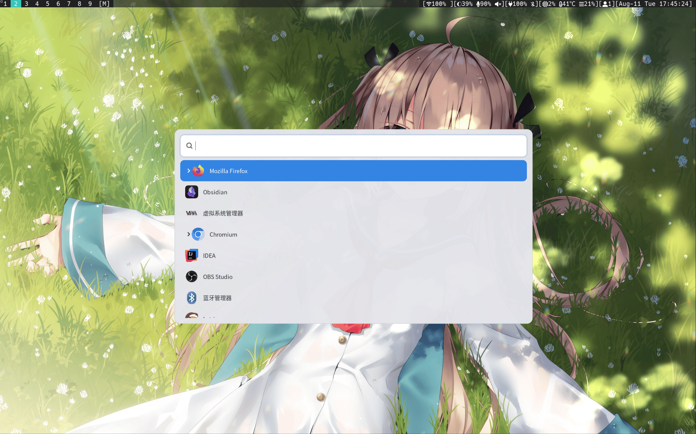
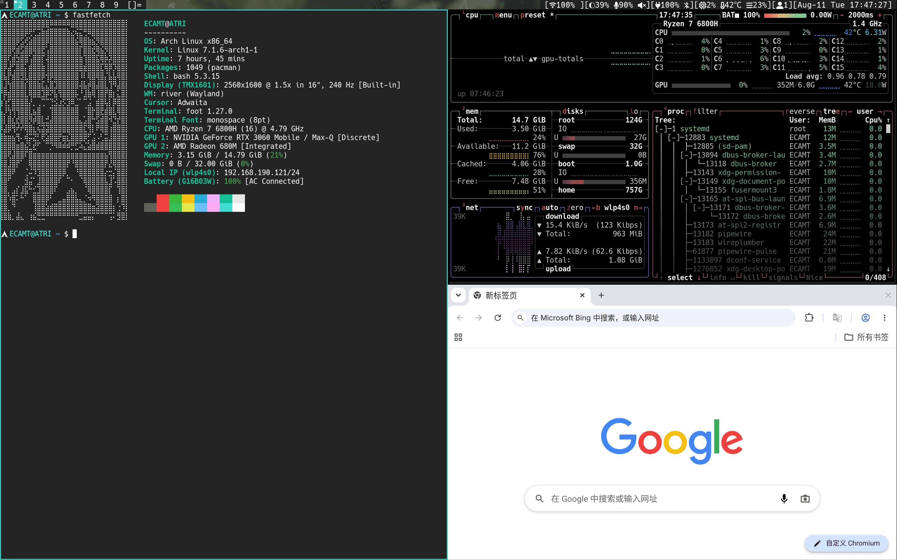

可使用`install-base.sh`快速安装系统所需基础组件包。
本配置主要面对的是桌面环境是WM Wayland，如`river-classic`, `labwc`等。
`river-classic`是现维护的WM配置，采用了rivercarro, dam作为组件，其中rivercarro（布局管理器）已编译好二进制放到`.local/bin`目录，亦可以删除去yay安装替代。dam（状态栏）因设计原因只能修改代码来个性化定制，并未编译到本仓库。
`./system`目录存放的是系统根目录相关配置的模板，如需要则按需引入并修改，不需要可移除。
