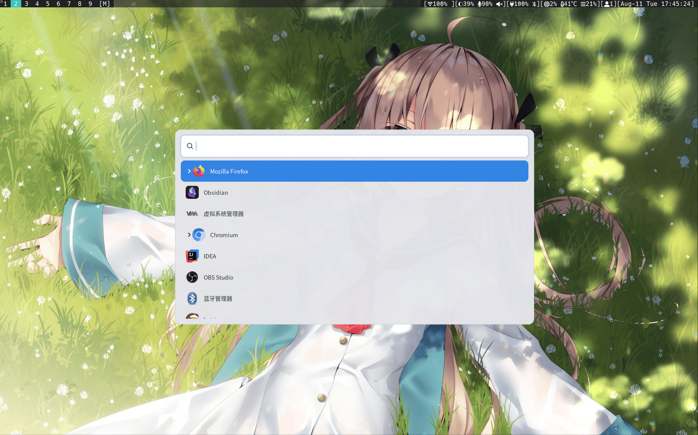
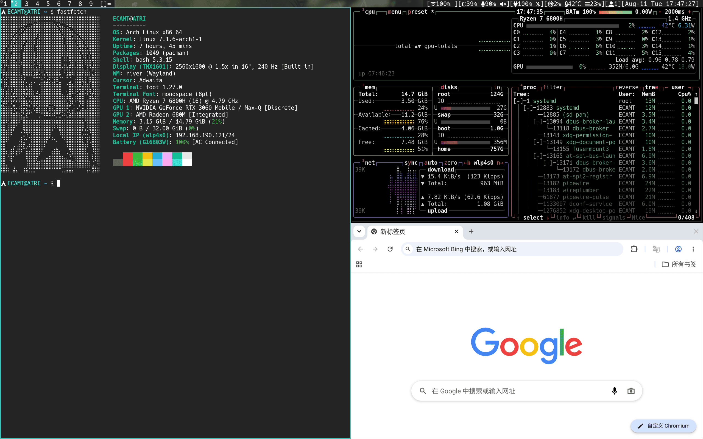

本配置主要面对的是桌面环境是WM Wayland，如`river-classic`, `labwc`等。

`river-classic`是现维护的WM配置，采用了rivercarro, dam作为组件。
其中rivercarro（布局管理器）已编译好二进制放到`.local/bin`目录，亦可自行使用yay安装/本地编译替代。
dam（状态栏）因设计原因只能修改文件再编译来个性化定制，本仓库提供一个案例`.config/dam/config.h`与编译好的二进制`.local/bin/dam`。

`./system`目录存放的是系统根目录相关配置的模板，可按需引入并修改，不需要可移除。

可使用`install-base.sh`快速安装系统所需基础组件包。

